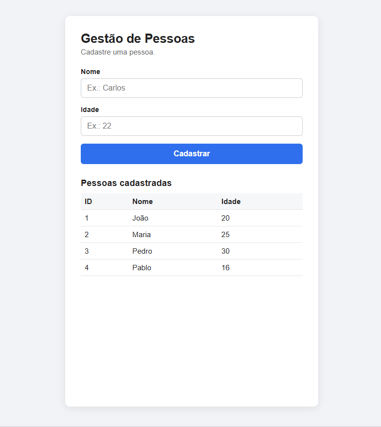
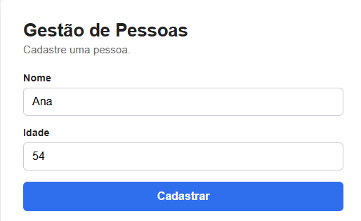
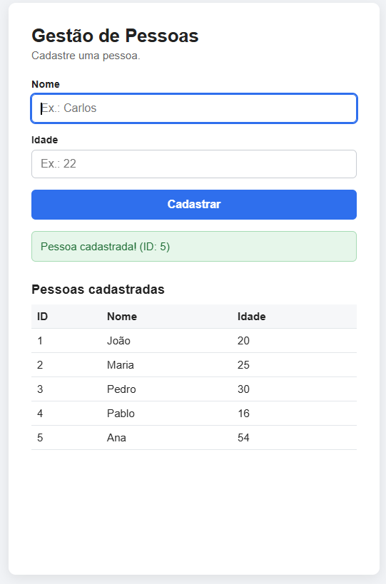
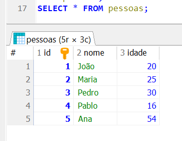

# Front-End – Sistema de Gestão de Pessoas

**Atividade 08 – Consumindo o Back-End no Front-End – CRUD**

**Professor:** Vitor Lima Santana  
**Aluno(a):** Pablo Vinícius Alves Pisolato  
**Disciplina:** Programação Back-End

## 1. Objetivo

Desenvolver uma aplicação Front-End utilizando HTML, CSS e JavaScript para consumir uma API REST desenvolvida em Node.js, Express e MySQL/MariaDB.

A atividade tem como foco implementar o cadastro de pessoas utilizando o método HTTP **POST**, a função `fetch()` e o tratamento de erros com `async/await` e `try/catch`.

## 2. Tecnologias utilizadas

- HTML5
- CSS3
- JavaScript
- Fetch API
- Async/Await
- Try/Catch
- Node.js e Express (Back-End)
- MySQL/MariaDB (Banco de dados)

## 3. Estrutura do projeto

```text
frontend-gestao-pessoas/
│
├── index.html
├
│
├── css/
│   └── style.css
│
├── js/
│   ├── script.js
│
└── README.md
```

## 4. Funcionalidades

O sistema possui as seguintes operações:

| Método | Rota | Funcionalidade |
|---|---|---|
| GET | /pessoas | Listar pessoas |
| GET | /pessoas/:id | Consultar pessoa |
| POST | /pessoas | Cadastrar pessoa |
| PUT | /pessoas/:id | Atualizar pessoa |
| DELETE | /pessoas/:id | Excluir pessoa |

## 5. Implementação do POST

O aluno deverá desenvolver o arquivo `js/cadastro.js`, responsável por capturar os dados do formulário HTML e enviá-los para a API.

A implementação deverá utilizar:

- `addEventListener("submit", ...)`
- `preventDefault()`
- `async/await`
- `try/catch`
- `fetch()`
- `method: "POST"`
- `JSON.stringify()`
- Verificação de `resposta.ok`

### Exemplo da estrutura de requisição

```javascript
const resposta = await fetch(
  "http://localhost:3000/pessoas",
  {
    method: "POST",
    headers: {
      "Content-Type": "application/json"
    },
    body: JSON.stringify({
      nome,
      idade
    })
  }
);
```

O código deverá estar dentro de uma função assíncrona, com tratamento de erros utilizando `try/catch`.

O aluno também deverá validar os campos nome e idade antes de enviar os dados.

## 6. Como executar

### Back-End

1. Realizar o Fork do repositório original disponibilizado pelo professor.
2. Clonar o repositório.
3. Instalar as dependências:

```bash
npm install
```

4. Configurar a conexão com o banco de dados.
5. Iniciar a API:

```bash
npm start
```

A API estará disponível em:

`http://localhost:3000`

### Front-End

1. Abrir o projeto no Visual Studio Code.
2. Verificar se o Back-End está funcionando.
3. Executar `index.html` com o Live Server.
4. Acessar a página de cadastro.
5. Cadastrar uma pessoa.
6. Verificar se os dados foram armazenados no banco de dados.

## 7. Evidências

Adicione capturas de tela demonstrando:

**Imagem 1 – Tela de listagem**



**Imagem 2 – Formulário de cadastro**



**Imagem 3 – Cadastro funcionando**



**Imagem 4 – Registro inserido no banco de dados**



## 8. Repositórios

**Back-End (Fork):** https://github.com/Pablo-Vinicius-Alves/ProjetoFullStack.git

**Front-End:** https://github.com/Pablo-Vinicius-Alves/frontend-gestao-pessoas.git

## 9. Conclusão do aluno

Explique com suas palavras:

- Como funciona a comunicação entre o Front-End e o Back-End?
- Qual é a finalidade do método POST?
- Por que utilizamos `async/await` e `try/catch`?
- Quais dificuldades você encontrou durante a atividade?

- O Front-End é a parte que o usuário vê e usa no navegador. O Back-End é a API, que fica rodando no servidor e conversa com o banco de dados. Os dois se comunicam por requisições HTTP: o Front-End envia uma requisição para um endereço da API, o back-end processa, acessa o banco e devolve uma res em JSON.
- O POST serve para enviar dados ao servidor com o objetivo de criar um novo registro.
- Uma requisição `fetch()` leva um tempo para ser respondida, pois depende da rede e do servidor. O `async/await` permite que o código espere essa resposta sem travar a página, melhor experiência do software. O `try/catch` serve para tratar erros. Se o servidor estiver desligado, a conexão falhar ou a API responder com erro, o código não quebra: o `catch` captura o problema e exibe no front para poder identificar que algo deu errado.
-Fazer a parte das ações do front-end responsivo.

---

## Créditos

**Professor responsável:** Vitor Lima Santana

**Desenvolvido por:** Pablo Vinícius Alves

**Atividade 08 – Desenvolvimento Web e Consumo de APIs REST**
